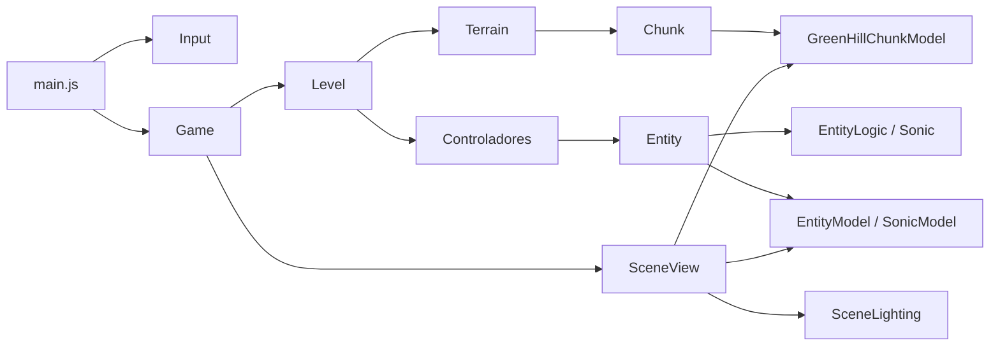

# Arquitetura da mini engine

Este documento descreve a implementação atual do jogo. A engine é específica deste projeto: coordena regras, terreno, entidades e uma cena Three.js. Ela separa dados de jogo de objetos gráficos para que movimento e colisão possam ser compreendidos e testados sem renderizar uma página.

## Visão geral e responsabilidades

| Camada | Arquivos principais | Responsabilidade |
| --- | --- | --- |
| Entrada e execução | `src/main.js`, `src/game/logic/Input.js` | Capturar teclas, manter o loop, calcular `dt` e atualizar HUD/overlay. |
| Coordenação | `src/game/Game.js`, `src/game/Level.js` | Construir a partida, reunir terreno, entidades e controladores, decidir derrota e sincronizar a cena. |
| Regras | `src/game/logic/` | Guardar posição, velocidade, ações, terreno, física e hitboxes sem depender de Three.js. |
| Ponte entre camadas | `src/game/entities/Entity.js` | Manter lógica e modelo visual alinhados. |
| Apresentação | `src/game/rendering/` | Criar malhas, materiais, animações, luzes, câmeras e renderizar. |
| Recursos | `public/assets/`, `public/model-imports/` | Servir skybox, modelos e texturas por URL. |

`Game` possui um `Level` e uma `SceneView`. `Level` possui um `Terrain`, as entidades Sonic/BuzzBomber e seus controladores. Cada `Entity` reúne uma `EntityLogic` e uma `EntityModel`. O modelo não decide colisões nem altera a velocidade; a lógica não manipula `THREE.Mesh`, câmeras ou materiais.

As setas indicam colaboração ou passagem de dados; `Chunk` e `GreenHillChunkModel` não têm relação de herança. A cena recebe modelos já associados a entidades e cria modelos de terreno a partir dos chunks lógicos.

## Construção da partida

1. `main.js` encontra canvas, HUD e overlay, instancia `Input`, registra eventos de teclado e redimensionamento e chama `Game.startGame()`.
2. `Game.startGame()` cria `Level` e espera `buildLevel()`. `Level` cria cinco chunks iniciais, calcula a altura inicial, carrega os modelos de Sonic e BuzzBomber com `GLTFLoader` e constrói as respectivas `Entity`.
3. O construtor de `Entity` mede a caixa do modelo com `THREE.Box3`, inicializa a hitbox lógica, prepara a caixa visual de depuração e aplica um deslocamento para alinhar o centro visual à origem lógica.
4. `Level` posiciona as entidades em relação ao terreno. O Sonic recebe uma função `groundAt(x)` que retorna altura e normal da superfície; o BuzzBomber atual fica estático, sem gravidade.
5. `Level` associa `PlayerController` ao Sonic e `StaticController` ao BuzzBomber. `Game` cria `SceneView`, adiciona modelos e chunks, sincroniza câmera/luzes e muda o estado para `playing`.

O loop de `main.js` começa antes de terminar o carregamento assíncrono. Durante esse intervalo, `Game.update()` retorna porque o estado ainda é `menu`. Não há tela de carregamento própria; a skybox temporária é carregada por callback da `TextureLoader`.

## Ordem de um quadro

`main.js` usa `requestAnimationFrame` e `THREE.Timer`. Em cada quadro, calcula `dt = min(delta, CONFIG.maxDt)`, com máximo atual de 0,05 s, e chama `Game.update(dt)`. O limite evita um salto físico grande após uma pausa do navegador.

1. Se o estado não for `playing`, `Game.update()` termina sem mover ou renderizar uma nova cena.
2. `Level.update()` chama `updateEntity(dt)` nos dois controladores. O `PlayerController` lê as teclas, envia ações ao Sonic e atualiza sua entidade. O `StaticController` apenas atualiza a entidade que controla.
3. `Entity.update()` executa a lógica, reflete eventuais mudanças de altura da hitbox na caixa de depuração, copia a posição lógica para a raiz visual e atualiza animações.
4. `Level` impede que o Sonic volte além do início do primeiro chunk disponível e chama `Terrain.update(x)`. O terreno devolve todos os chunks criados naquele quadro.
5. `SceneView.updateChunks()` acrescenta as novas malhas e descarta as antigas. `Game` verifica colisão entre Sonic e BuzzBomber e, se houver contato, muda o estado para `lose`.
6. `Game.syncScene()` acompanha a posição do Sonic e a altura do terreno com as câmeras e luzes, depois renderiza. Por fim, `main.js` atualiza distância, velocidade e overlay.

A distância mostrada no HUD vem de `Game.getDistance()`: `posiçãoX do Sonic - startPosX`. Ela ainda não constitui um sistema separado de pontuação.

## Entrada, ações e controladores

`Input` armazena `KeyboardEvent.code` em um `Set`: `keydown` insere, `keyup` remove e `isDown(code)` consulta o estado. Isso permite pressionar mais de uma tecla ao mesmo tempo sem depender da repetição de eventos do navegador. `PlayerController.AVAILABLE_INPUTS` traduz as teclas em ações:

| Ação | Teclas | Efeito atual |
| --- | --- | --- |
| `MOVE_LEFT` / `MOVE_RIGHT` | A/←, D/→ | Acelera ou freia no eixo X. |
| `JUMP` | Espaço | Salta; manter pressionado causa novo salto ao pousar. |
| `CROUCH` | Ctrl esquerdo/direito | Reduz o limite de velocidade horizontal à metade. |
| `BOOST` | Shift esquerdo/direito | É registrada, mas ainda não modifica a física. |

`Entity.handleAction(action, state)` encaminha a ação para `logic.do()` ou `logic.stop()`, que alteram `currentActions`. O controlador decide *qual* intenção existe; a entidade decide *como* ela afeta sua física. `StaticController` conserva a mesma interface de atualização, embora não envie comandos de movimento. A tecla C, usada para alternar câmeras, é tratada diretamente em `main.js`.

## Entidades, posição e hitboxes

`EntityLogic.position` representa o **centro da hitbox**, não os pés nem a origem do arquivo 3D. `EntityModel.root` é um `THREE.Group` que acompanha essa posição. `setVisualOffset()` desloca só o modelo filho para que o centro calculado do modelo coincida com o centro lógico. Assim, escala e orientação do arquivo importado podem ser corrigidas sem transformar a posição física da entidade.

`Entity.setHitbox(length, height, depth)` atualiza a lógica e a caixa de depuração juntas. A lógica guarda o campo `heigth` (grafia usada atualmente no código) e a caixa visual usa `height`; ambos significam a altura no eixo Y. `setOnGround(groundY)` coloca o centro lógico em `groundY + altura/2`. O `Box3Helper` é apenas uma ferramenta visual: a colisão usa os números guardados em `EntityLogic`.

Há dois ajustes específicos já aplicados:

- O BuzzBomber mantém a altura e a profundidade medidas do modelo, mas usa 80% da largura medida em X.
- O Sonic usa 60% da altura normal durante `Spin`. A largura e a profundidade não mudam. Quando volta ao chão, a posição central é ajustada para preservar a base da hitbox.

`EntityLogic.checkCollision(other)` compara caixas alinhadas aos eixos. Em X, por exemplo, há contato quando `abs(x1 - x2) <= (largura1 + largura2) / 2`; a condição deve valer também em Y e Z. `checkEventRegion()` faz comparação semelhante com uma margem de 2 unidades por eixo, e existe um `Set` chamado `inEventRegion`. Essa região ainda não participa do fluxo principal: `Game` verifica diretamente o par Sonic–BuzzBomber a cada quadro.

## Movimento e contato com o terreno

`EntityLogic.update(dt)` aplica salto quando `JUMP` está ativa, chama `updateHorizontalSpeed(dt)` e atualiza X, Y e Z. O deslocamento horizontal é `x += speed.x * dt`. Entidades sem gravidade apenas somam `speed.y * dt` à altura. Para entidades com gravidade, `groundAt(x)` informa a superfície sob a posição horizontal atual:

- Em contato com o chão, `y = alturaDaSuperfície + alturaDaHitbox/2`; a velocidade vertical acompanha a inclinação por meio da normal.
- No ar, a posição integra a velocidade vertical e a velocidade recebe `CONFIG.gravity * dt`. Ao descer até a superfície, a entidade pousa, zera a velocidade vertical e marca `onGround = true`.
- `jump()` só inicia se `onGround` for verdadeiro; atribui `CONFIG.jumpVelocity` à velocidade Y e marca a entidade como aérea.

`Sonic` especializa a aceleração no eixo X. Com uma direção pressionada, a força de movimento pode levar até `CONFIG.runSpeedLimit` (20 u/s); o momento obtido em descidas pode ultrapassar esse limite. Soltar a direção ou pressionar o lado oposto ativa a frenagem física, mais leve no ar. Em rampas, a normal fornecida pelo terreno projeta parte da gravidade no deslocamento horizontal. O estado visual `Brake` começa quando o Sonic, no chão e acima de 7 u/s, tenta mover-se no sentido oposto. Ele permanece ativo abaixo desse limiar até a parada ou a inversão de movimento.

## Chunks, continuidade e geometria

`Chunk` é a descrição lógica de um trecho. As estratégias `flat`, `rampUp` e `rampDown` estão em `src/game/logic/terrain/Chunk.js`; cada uma fornece `heightAt(xLocal, baseY, theta)` e `normalAt(xLocal, theta)`. `Chunk.length = 40`, `depth = 10`, `soilDepth = 3` e o ângulo padrão `theta = 0,05` radiano. `initialX` é o início global, `baseY` é a altura do topo ali e `endY` é a altura no fim. `getHeightAtX()` e `getNormalVector()` convertem X global para local.

`surfaceStart` acumula a distância percorrida *sobre* a superfície, separada de `initialX`. O fim é `surfaceEnd = surfaceStart + hypot(length, endY - baseY)`. `Terrain` usa `endY` e `surfaceEnd` do último chunk para criar o seguinte: o primeiro mantém continuidade de altura; o segundo mantém continuidade das coordenadas UV da grama. As estratégias são sorteadas sem restrição de transição, portanto uma troca brusca entre rampas ainda pode produzir uma quina.

`Terrain` cria cinco chunks iniciais. Quando o X do Sonic alcança o início do terceiro chunk da lista, acrescenta outro na frente e remove o mais antigo. Um `while` repete a operação se o personagem avançar mais de um trecho em um quadro. `getHeightAt(x)` e `getNormalVectorAt(x)` consultam o chunk que contém X; fora dos chunks ativos, a altura é `null`.

Na apresentação, `TerrainModel` cria um `GreenHillChunkModel` por chunk. Este gera uma `BufferGeometry` com quatro vértices e dois triângulos por face, preenchendo `positions`, `uvs` e `indices`. A parte inferior de cada ponta fica `soilDepth` abaixo do topo correspondente. Os materiais usam `CanvasTexture`: a terra tem quadrados alternados e a grama, listras. `RepeatWrapping` repete os padrões; as coordenadas globais e `surfaceStart` evitam reiniciar o padrão a cada bloco. O topo usa `u = distânciaSobreSuperfície / 2,9` e `v = z / 4`. Ao descartar um trecho, `destroyChunk()` remove a malha e libera geometria, texturas e materiais. A derivação das faces e das UVs está em [montagem-chunks.md](montagem-chunks.md).

## Cena, luzes e animações

`SceneView` mantém uma cena, um `WebGLRenderer` ligado ao canvas e duas `PerspectiveCamera`: lateral e oblíqua. `switchCamera()` alterna entre elas. `resize()` atualiza proporção, matriz de projeção e tamanho do renderer. `sync()` move câmeras e luzes conforme o X do Sonic e a altura do terreno. `SceneLighting` adiciona luz ambiente, luz direcional principal com sombras e luz direcional de preenchimento. A skybox atual é uma imagem temporária em `public/assets/`.

Os modelos de Sonic e BuzzBomber são carregados por fábricas assíncronas antes de construir `Entity`. `SonicModel` usa `AnimationMixer` e escolhe `Spin` no ar ou enquanto Espaço está pressionado, `Brake` durante frenagem, `Idle` parado, `Walk` abaixo de 20 u/s e `Jog` a partir de 20 u/s. `Brake` repete em loop até a frenagem terminar. As ações trocam com `fadeOut`/`fadeIn` de 0,15 s. `Walk` e `Jog` aceleram a reprodução com a velocidade; `Spin` usa a velocidade total com um ritmo mínimo. A orientação muda apenas quando o sinal da velocidade X muda. Uma pequena elevação visual compensa o deslocamento vertical da animação de `Spin`.

## Estado atual, testes e pontos de extensão

`Game.state` começa como `menu`, passa a `playing` após o carregamento e vira `lose` na colisão. O HUD mostra distância, velocidade e estado. Em derrota, `main.js` espera o Espaço ser solto antes de aceitar outro pressionamento para recarregar a página. O construtor de `Level` aceita `finishX`, mas esse parâmetro ainda não produz vitória; modo distância, modo infinito selecionável e pausa também não estão implementados.

Os testes em `tests/` usam o test runner do Node. Eles verificam chunks, colisão, controle, física, animações e luzes com objetos simples. Para mudanças na engine, executem `npm test`, `npx eslint src tests` e `npm run build`; depois testem a cena em navegador, inclusive rampas, troca de câmera e tamanho da janela. A construção do modo distância deve se concentrar em `Game`/`Level`; uma nova entidade deve fornecer lógica, modelo e controlador quando necessário, preservando a separação de responsabilidades acima.
