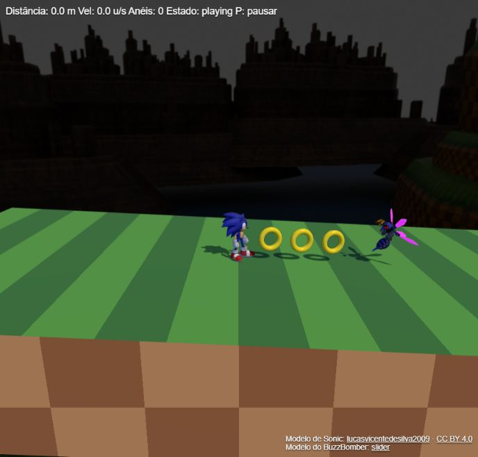
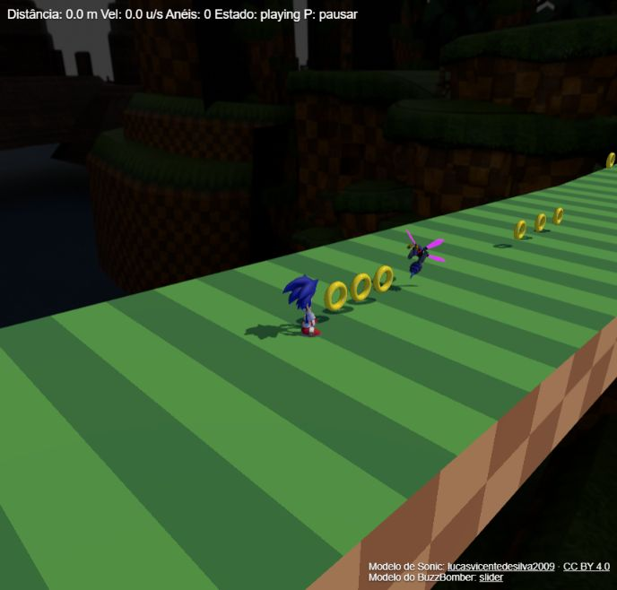
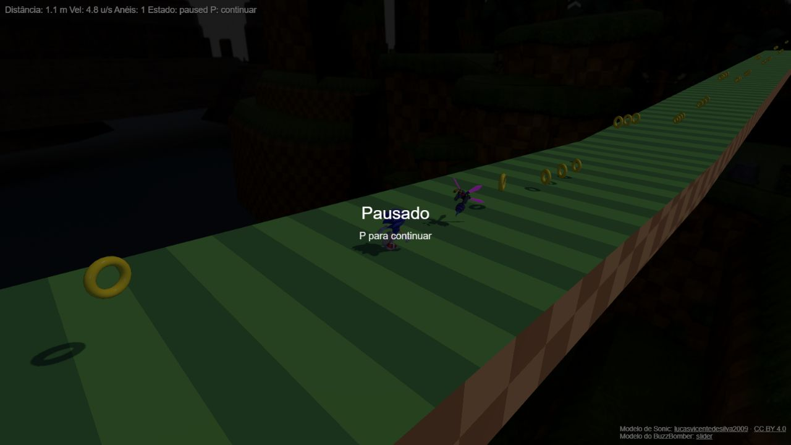
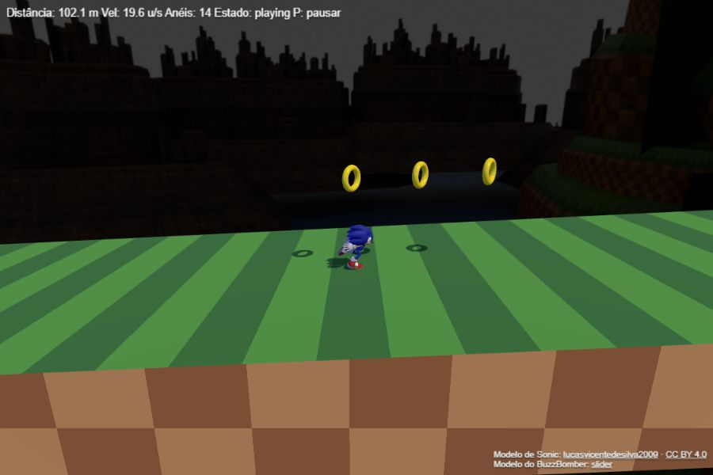
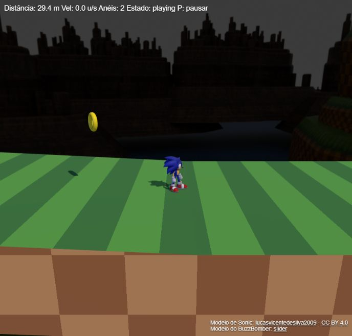
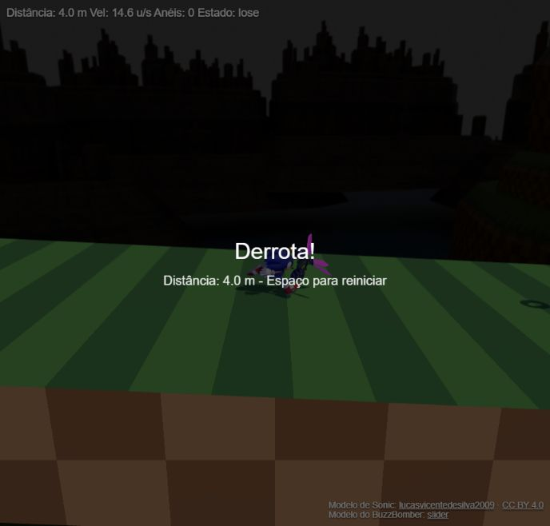

# Sistema de anéis

Sistema integrado à `main`, com estado em `Level` e entidades integradas ao fluxo existente. Não foram adicionadas dependências. O modelo, `scene.bin` e a licença estão versionados em `public/model-imports/sonic_ring/`; a atribuição está em `model-credits.md`.

## Comportamento e adaptações do GDD

- Cada fase carrega o GLTF uma vez, usando `import.meta.env.BASE_URL`. Os clones compartilham geometria e materiais, mas têm pivôs, posições e rotações independentes. A orientação original já deixa a face no plano X/Y; o pivô é recentralizado antes da rotação em Y.
- Escala escolhida: **0,05 unidade por pixel**. O diâmetro de 16 px corresponde a **0,8 unidade**; a AABB centralizada mede **0,6 × 0,6 × 0,8**, sendo largura e altura 75% do diâmetro. A profundidade cobre a faixa Z do jogador. A rotação fica apenas no visual. A depuração usa o helper de hitbox existente.
- Cada chunk tem nove posições de layout, identificadas por `initialX:índice`. A altura parte da superfície do próprio chunk. O trio inicial está em X=1, 2 e 3, antes do BuzzBomber em X=5, inclusive nas rampas; três posições por chunk ficam 2,8 unidades acima do chão para salto. Chunks são inicializados uma vez e suas coletas ficam registradas até o descarte. Só os oito chunks ativos mantêm anéis estáticos e registros de layout.
- A coleta usa a colisão contínua existente do Sonic. Desativa imediatamente a hitbox, consome mesmo no teto de **999**, incrementa o saldo e também `ringsCollected`. A nota usa o total, incluindo recoletas; o HUD e as telas finais mostram o saldo, e o resultado final exibe **saldo / total coletado**.
- Quatro etapas de brilho de 60 ms totalizam **0,24 s**. O efeito e seus recursos são descartados ao terminar. O som original usa oscilador Web Audio de 1100 a 1760 Hz e envelope de 120 ms, com panorama alternando esquerda/direita. O contexto só é ativado após teclado/clique; ausência ou falha de áudio não impede a coleta nem o brilho.
- As coletas elegíveis precedem o contato com inimigos. Sem saldo, o contato mantém o fluxo de derrota. Com saldo, um único impacto zera o saldo, preserva o total e aplica **vx=±4, vy=8 unidades/s**, afastando o jogador. A apresentação reutiliza o Spin existente. O controlador deixa de emitir comandos durante a reação, enquanto a física mantém o impulso. O bloqueio acaba no pouso; a invulnerabilidade de **2 s** expira separadamente. O visual alterna a cada **2/60 s** e restaura a visibilidade ao final.
- Dispersam-se no máximo 32 anéis ativos. O leque usa **101,25° + par × 22,5°**, com pares `vx=±abs(cos(ângulo)) × velocidade` e `vy=abs(sin(ângulo)) × velocidade`. A reflexão para o semiplano superior adapta o padrão ao X/Y com Y para cima: todos nascem subindo e algumas trajetórias se sobrepõem. A velocidade-base escolhida é **4 px/frame = 12 unidades/s** a 60 Hz; os anéis 17–32 repetem o padrão com **6 unidades/s**. Impactos posteriores retiram só a quantidade necessária dos espalhados ativos mais antigos; efeitos de anéis já coletados não ocupam essa cota.
- Gravidade convertida: **−0,09375 × 60² × 0,05 = −16,875 unidades/s²**. Movimento e temporizadores usam segundos. No contato descendente com chão/rampa, a base da AABB é corrigida para `Terrain.getHeightAt(x)` e `vy` é invertido com fator **0,75**. Impulsos menores que a velocidade adquirida pela gravidade em um passo são estabilizados em zero. `null` significa ausência de superfície.
- Recoleta a partir de **64/60 s** do impacto; expiração em **256/60 s**, com prioridade sobre coleta no mesmo update. A rotação cai linearmente nos últimos **64/60 s**. Espalhados continuam atualizando fora da câmera e sobrevivem ao descarte do chunk de origem até expirar. Adições e remoções são encaminhadas à cena no mesmo update. A pausa congela física, brilho, invulnerabilidade e tempos dos anéis; o reinício existente recarrega uma fase nova.

## Arquivos alterados

- Lógica e integração: `src/game/Level.js`, `src/game/Game.js`, `src/game/logic/entities/Ring.js`, `src/game/logic/entities/EntityLogic.js`, `src/game/logic/entities/Sonic.js`, `src/game/logic/controllers/PlayerController.js`.
- Apresentação: `src/game/rendering/entities/RingModel.js`, `src/game/rendering/RingAudio.js`, `src/game/rendering/entities/SonicModel.js`, `src/game/rendering/SceneView.js`, `src/main.js`.
- Regressões: `tests/rings.test.js`, `tests/game.test.js`, `tests/enemies.test.js`, `tests/player-controller.test.js`. Os mocks existentes foram ajustados às novas interfaces; o mock de chegada já estava incompleto e recebeu `drawFinishLine`.
- Documentação: `docs/model-credits.md`, este relatório, `docs/rings-pr.md` e seis capturas em `docs/evidence/rings-*.jpg`.

## Verificações realizadas

- `npm test` (`node --test`): **42 testes passaram**. Cobre coleta única e em alta velocidade, persistência após remoção do efeito, reset, teto, prioridade da coleta, dano protegido/sem proteção, preservação do total e nota, invulnerabilidade, impulso e bloqueio até pouso, limite e ordem de descarte, quique em plano/rampas, terreno ausente, limites de recoleta/expiração, desaceleração visual, descarte de chunk e pausa.
- `npx eslint src`: passou, sem erros.
- `npm run build`: passou com base `/cinos-the-hedgehog-2/`. O Vite avisa que o bundle supera 500 kB (658,19 kB; 168,08 kB gzip). Não foi alterada a estratégia de bundle.
- `git diff --check`: passou em cada etapa; o Git apenas avisa sobre a conversão automática LF/CRLF em arquivos novos.
- Dependências já estavam instaladas; `npm ci` não foi necessário.
- Navegador real: coleta dos anéis iniciais, dano do BuzzBomber com saldo, impulso, piscar, pouso, recoleta após o bloqueio, expiração, derrota sem saldo, pausa/retomada, reinício, salto com Espaço, troca com C, redimensionamento para 900×600 (depois restaurado), passagem por vários chunks e chegada em 1000 m. Console sem erros ou avisos. Partida concluída com **saldo 120, total 123 e nota A**, evidenciando a preservação do total após perda de saldo. A reprodução não forneceu retorno auditivo para avaliar o timbre; a integração Web Audio não gerou erros no console.
- Testes de tempo usam o relógio lógico em segundos; os limites exatos e a expiração fora da câmera foram verificados automaticamente.

## Evidências

